# HW7.

## 1. Базовые операции с транзакциями

### 1.1. Begin и commit

```sql
BEGIN;
UPDATE Ticket SET status = 'Sold' WHERE ticketID = 1003;
UPDATE Session SET price = price + 50.00 WHERE sessionID = 102;
COMMIT;
SELECT ticketID, status, sessionID FROM Ticket WHERE ticketID = 1003;
SELECT sessionID, price FROM Session WHERE sessionID = 102;
```

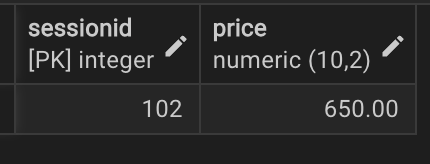

### 1.2. То же самое, но с rollback

```sql
BEGIN;
UPDATE Ticket SET status = 'Returned' WHERE ticketID = 1003;
UPDATE Session SET price = price + 100.00 WHERE sessionID = 102;
ROLLBACK;
SELECT ticketID, status, sessionID FROM Ticket WHERE ticketID = 1003;
SELECT sessionID, price FROM Session WHERE sessionID = 102;
```

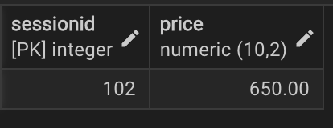

### 1.3. С ошибкой внутри транзакции

```sql
BEGIN;
UPDATE Ticket SET status = 'Returned' WHERE ticketID = 1003;
UPDATE Session SET price = price + 100.00 WHERE sessionID = 102;
SELECT 1 / 0;
```

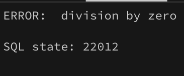

```sql
ROLLBACK;
SELECT ticketID, status FROM Ticket WHERE ticketID = 1003;
SELECT sessionID, price FROM Session WHERE sessionID = 102;
```

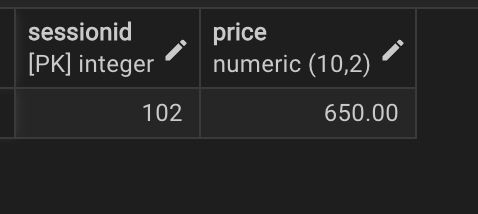

## 2. Уровни изоляции

### 2.1. `READ UNCOMMITTED` и `READ COMMITTED`

T1:

```sql
BEGIN ISOLATION LEVEL READ UNCOMMITTED;
UPDATE Ticket SET status = 'Booked' WHERE ticketID = 1003;
```

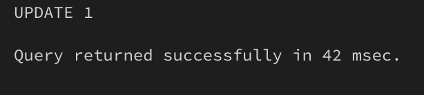
T2:

```sql
BEGIN ISOLATION LEVEL READ UNCOMMITTED;
SELECT ticketID, status FROM Ticket WHERE ticketID = 1003;
COMMIT;
```

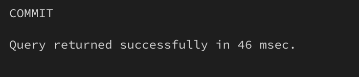
T1:

```sql
ROLLBACK;
```

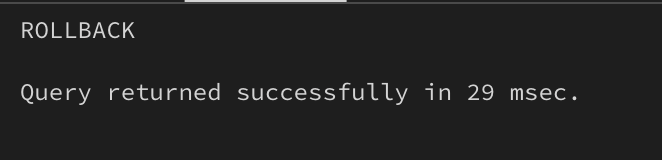

### 2.2. Неповторяющееся чтение: `READ COMMITTED`

T1:

```sql
BEGIN ISOLATION LEVEL READ COMMITTED;
SELECT status FROM Ticket WHERE ticketID = 1003;
SELECT status FROM Ticket WHERE ticketID = 1003;
COMMIT;
```

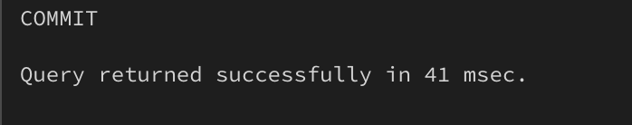
T2:

```sql
BEGIN;
UPDATE Ticket SET status = 'Booked' WHERE ticketID = 1003;
COMMIT;
```

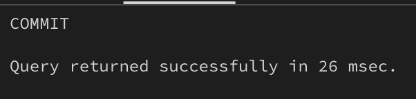

### 2.3. `REPEATABLE READ`

В T1:

```sql
BEGIN ISOLATION LEVEL REPEATABLE READ;
SELECT status FROM Ticket WHERE ticketID = 1005;
SELECT status FROM Ticket WHERE ticketID = 1005;
COMMIT;
```

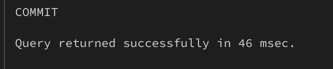

```sql
BEGIN;
UPDATE Ticket SET status = 'Sold' WHERE ticketID = 1005;
COMMIT;
```

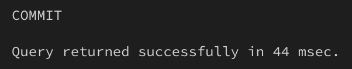

### 2.4. Проверка фантомов: `REPEATABLE READ`

T1:

```sql
BEGIN ISOLATION LEVEL REPEATABLE READ;
SELECT count(*) FROM Ticket WHERE status = 'Booked';
SELECT count(*) FROM Ticket WHERE status = 'Booked';
COMMIT;
```

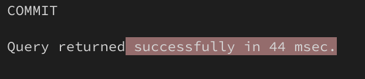
T2:

```sql
BEGIN;
INSERT INTO Ticket (ticketID, status, sessionID, placeID, customer_email)
VALUES (1099, 'Booked', 101, 1, 'phantom@example.com');
COMMIT;
```

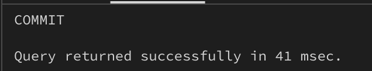

```sql
DELETE FROM Ticket WHERE ticketID = 1099;
```

### 2.5. Конфликт `SERIALIZABLE`

T1:

```sql
BEGIN ISOLATION LEVEL SERIALIZABLE;
SELECT status FROM Ticket WHERE ticketID = 1003;
```

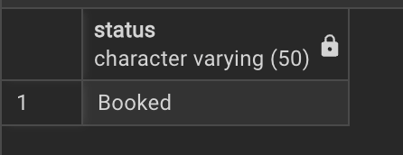
T2:

```sql
BEGIN ISOLATION LEVEL SERIALIZABLE;
SELECT status FROM Ticket WHERE ticketID = 1003;
```

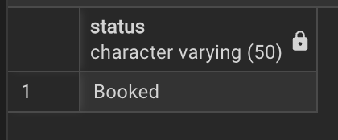
T1:

```sql
UPDATE Ticket SET status = 'Sold' WHERE ticketID = 1003;
COMMIT;
```

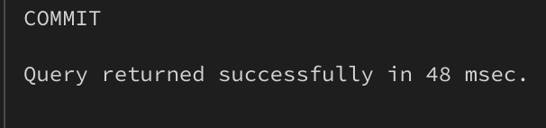
T2:

```sql
UPDATE Ticket SET status = 'Booked' WHERE ticketID = 1003;
```

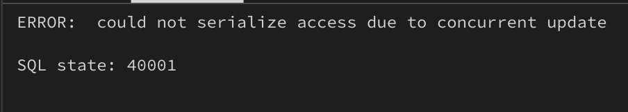
T2:

```sql
ROLLBACK;
```

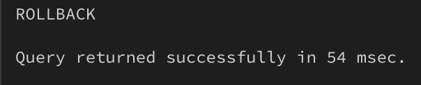
---------- повтор Т2

```sql
BEGIN ISOLATION LEVEL SERIALIZABLE;
SELECT status FROM Ticket WHERE ticketID = 1003;
UPDATE Ticket SET status = 'Booked' WHERE ticketID = 1003;
COMMIT;
SELECT status FROM Ticket WHERE ticketID = 1003;
```

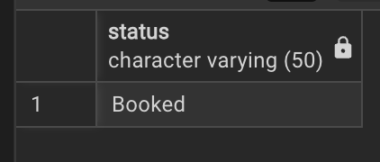

## 3. SAVEPOINT

### 3.1. Откат части изменений

```sql
BEGIN;
UPDATE Ticket SET status = 'Booked' WHERE ticketID = 1003;
SAVEPOINT before_price_change;
UPDATE Session SET price = price + 25.00 WHERE sessionID = 102;
ROLLBACK TO SAVEPOINT before_price_change;
SELECT ticketID, status FROM Ticket WHERE ticketID = 1003;
SELECT sessionID, price FROM Session WHERE sessionID = 102;
COMMIT;
```

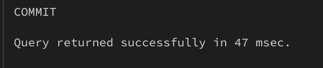

### 3.2. Две точки сохранения

```sql
BEGIN;
UPDATE Ticket SET status = 'Returned' WHERE ticketID = 1003;
SAVEPOINT sp_first;
UPDATE Ticket SET status = 'Booked' WHERE ticketID = 1003;
SAVEPOINT sp_second;
UPDATE Ticket SET status = 'Sold' WHERE ticketID = 1003;
ROLLBACK TO SAVEPOINT sp_second;
SELECT status FROM Ticket WHERE ticketID = 1003;
ROLLBACK TO SAVEPOINT sp_first;
SELECT status FROM Ticket WHERE ticketID = 1003;
COMMIT;
SELECT status FROM Ticket WHERE ticketID = 1003;
```

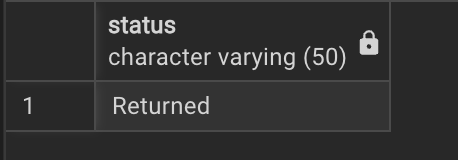

## Выводы

- `COMMIT` сохраняет связанные изменения, а `ROLLBACK` отменяет все изменения текущей транзакции.
- Ошибка SQL прерывает транзакцию; `ROLLBACK` отменяет предшествующие изменения.
- В PostgreSQL грязное чтение невозможно: `READ UNCOMMITTED` работает как `READ COMMITTED`.
- `READ COMMITTED` допускает неповторяющееся чтение, потому что снимок обновляется для каждого оператора.
- `REPEATABLE READ` сохраняет один снимок на всю транзакцию и не показывает вставленные параллельно строки.
- `SERIALIZABLE` обнаруживает конфликт сериализации; клиенту следует повторить транзакцию целиком.
- `SAVEPOINT` позволяет откатить часть действий, сохранив изменения до точки возврата.
